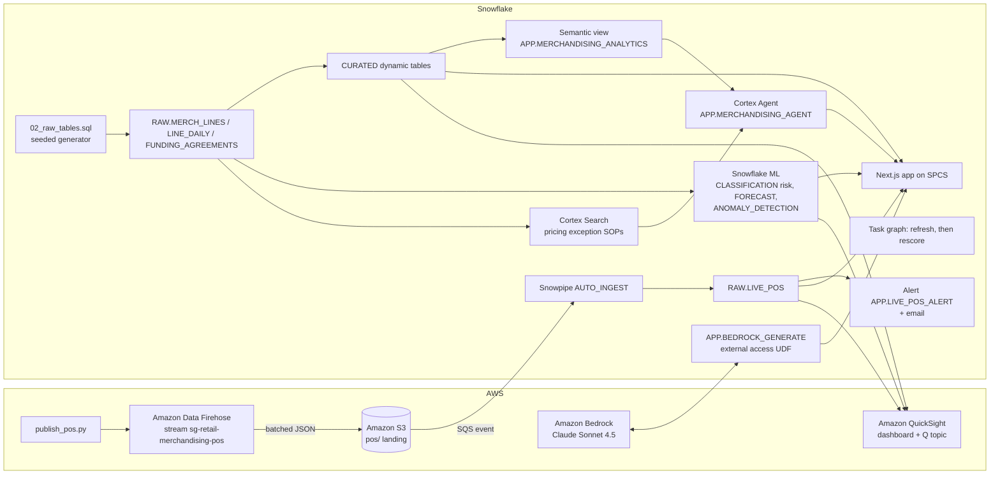

# Singapore Retail Merchandising - Pricing Exceptions and Markdown Risk

Merchandising and pricing control for **48 fictional merchandise lines of Tembusu Fresh Mart, a fictional Singapore supermarket chain**. Each line is one product category ranged in the store cluster of one of five real Singapore planning areas (HDB towns) used as regions: Bukit Batok, Sengkang, Toa Payoh, Bedok and Yishun. Snowflake, optionally with AWS, takes the pricing team from a live point-of-sale (POS) pricing exception at a heartland outlet to a 7-day unplanned-markdown risk score per line, an alert email and an AI action memo. All amounts are in SGD.

## Architecture

The pipeline runs on **Snowflake** (Dynamic Tables, Snowflake ML, Cortex Search, Cortex Agent, Cortex AI_COMPLETE, SPCS) and, in the full build, also uses **AWS** (Amazon Data Firehose, S3, Bedrock Claude, QuickSight + Amazon Q). POS events arrive in `RAW.LIVE_POS`. Dynamic tables roll 90 days of line-day rows into units sold, net sales in SGD, pricing exceptions, unplanned markdowns, promo setup delays, price integrity rate and price audit compliance. Snowflake ML predicts which lines are likely to take an unplanned markdown in the next 7 days, forecasts pricing exceptions across the network and flags unusual markdown depth. A Cortex Agent answers with SQL and SOP citations, and an LLM drafts the pricing team's action memo.

Interactive diagrams (hover for object names): [Snowflake only](docs/architecture-snowflake.html) | [AWS + Snowflake](docs/architecture-aws.html). The app's Architecture & Data tab shows both, the current build first. Regenerate them with `python3 docs/build_architecture.py`.



In the Snowflake-only build there is no AWS subgraph: `APP.SIMULATE_POS` writes to `RAW.LIVE_POS`, and the app calls Cortex `AI_COMPLETE` in place of the Bedrock UDF.

## Snowflake Capabilities

| Capability | Implementation |
|-----------|---------------|
| Dynamic Tables | `CURATED.KPI_SUMMARY`, `PERFORMANCE_SUMMARY`, `EXCEPTION_SUMMARY`, `TREND_ANALYSIS`, built from the RAW tables |
| Snowflake ML | CLASSIFICATION of 7-day unplanned-markdown risk (`ML.MARKDOWN_RISK_SCORES`), a 14-day pricing-exception FORECAST, and markdown depth ANOMALY_DETECTION |
| Cortex Search | 14 synthetic pricing exception SOPs (one per product category and exception type) in `SEARCH.EXCEPTION_SOP_SEARCH` |
| Semantic View | `APP.MERCHANDISING_ANALYTICS` over merchandise lines, exception types, daily totals and risk |
| Cortex Agent | `APP.MERCHANDISING_AGENT`: Cortex Analyst over the semantic view, plus Cortex Search for SOP citations |
| Cortex AI | `AI_COMPLETE('claude-sonnet-4-5')` for grounded answers, and for the action memo in the Snowflake-only build |
| Alerts + Tasks | `APP.LIVE_POS_ALERT` logs EXCEPTION events and sends email; task graph `TASK_REFRESH_CURATED`, then `TASK_RESCORE_RISK` |
| Snowpark Container Services | Next.js app `APP.SG_RETAIL_MERCHANDISING_APP` with 6 tabs: Executive Cockpit, Predictive, Controls, Live POS, Ask AI, Architecture & Data |
| Snowpipe | `RAW.LIVE_POS_PIPE` AUTO_INGEST from S3 (AWS build only) |

## AWS Services

These run only in the AWS + Snowflake build.

| Service | Role in Demo |
|---------|-------------|
| Amazon Data Firehose | Direct PUT stream `sg-retail-merchandising-pos` takes simulated POS events and writes them to S3 in batches |
| Amazon S3 | Landing bucket (`pos/`); an event notification goes to the Snowpipe SQS queue |
| Amazon Bedrock | Claude Sonnet 4.5 drafts the action memo, called from Snowflake through an external-access UDF |
| Amazon QuickSight | DIRECT_QUERY merchandising dashboard over Snowflake (daily pricing exceptions, unplanned markdowns by line, unplanned-markdown risk) |
| Amazon Q | Natural-language questions over the QuickSight topic `sg-retail-merchandising-topic` |
| AWS IAM | Least-privilege roles for S3, Firehose and Bedrock |

## Personas

Both personas are fictional.

| Persona | Role | Key Questions |
|---------|------|---------------|
| **Farah Aziz** | Head of Pricing and Promotions, Tembusu Fresh Mart | "How many units sell without a pricing exception?" "Which exception types end in an unplanned markdown most often?" |
| **Daniel Koh** | Category Pricing Analyst, Tembusu Fresh Mart | "Which merchandise lines in which towns need a pricing review this week, and what does the SOP say to do?" |

## Data

Every table is synthetic and HASH-seeded, so a rebuild reproduces it. Tembusu Fresh Mart, its merchandise lines, suppliers and personas are fictional; the five planning areas are real Singapore HDB towns used only as regions. No real retailer's prices or performance are shown.

| Table | Rows | Description |
|-------|------|-------------|
| RAW.MERCH_LINES | 48 | Merchandise lines in 5 Singapore planning areas and 5 categories (Fresh produce, Snacks and beverages, Dairy and chilled, Household care, Personal care), with a pricing risk tier |
| RAW.LINE_DAILY | 4,320 | One row per line per day for 90 days: units sold, net sales (SGD), pricing exceptions, unplanned markdowns, promo setup delays, exception type, price audits, markdown depth and price change lead time |
| RAW.FUNDING_AGREEMENTS | 48 | Required, on-file and pending supplier funding agreements per line |
| SEARCH.EXCEPTION_DOCS | 14 | Synthetic pricing exception SOPs indexed for Cortex Search |
| RAW.LIVE_POS | Grows during the demo | Live POS events from Firehose (AWS build) or `APP.SIMULATE_POS` (Snowflake-only build) |
| ML.MARKDOWN_RISK_SCORES | 48 | 7-day unplanned-markdown probability and risk band per line |

## Build Instructions

### Prerequisites
- Snowflake account with ACCOUNTADMIN access, and Cortex AI enabled (AI_COMPLETE, Search, Agent).
- An X-Small warehouse with auto-suspend at or below 120 s, and an existing SPCS compute pool.
- Python 3.11+, `snowflake-connector-python`, Node.js 22+, Docker and the `snow` CLI.
- App image: run `snow spcs image-registry login`, then build and push `sg-retail-merchandising-app:v1` to the database's `APP.IMAGES` repository (see the header of `snowflake/07_deploy_app.sql`).
- AWS build only: `boto3`, AWS credentials for the target account (us-west-2) with Bedrock access, and QuickSight Enterprise.

### SPCS App
```
<DATABASE>.APP.SG_RETAIL_MERCHANDISING_APP
```

### Tests
```bash
python -m pytest aws snowflake quicksight
```

For a local run, put `SNOWFLAKE_ACCOUNT`, `SNOWFLAKE_USER`, `SNOWFLAKE_DATABASE`, `SNOWFLAKE_WAREHOUSE`, `SNOWFLAKE_AUTHENTICATOR=PROGRAMMATIC_ACCESS_TOKEN`, `SNOWFLAKE_TOKEN` and `DEMO_PLATFORM` in the environment, then run `npm --prefix app run build && npm --prefix app start`.

## Build Modes

The two modes run on one shared core and differ in three layers. The `DEMO_PLATFORM` value in the app SPCS spec selects the memo provider and the Live POS copy.

| Layer | Snowflake Only | Full AWS + Snowflake |
|---|---|---|
| Live POS | `CALL APP.SIMULATE_POS(n)` inserts simulated POS events into `RAW.LIVE_POS`. This simulates a POS feed; it is not Snowpipe Streaming | `aws/publish_pos.py` to Amazon Data Firehose, then S3, SQS and Snowpipe AUTO_INGEST |
| Action memo | Cortex `AI_COMPLETE('claude-sonnet-4-5')` | Amazon Bedrock Claude Sonnet 4.5 through `APP.BEDROCK_GENERATE` |
| BI and natural-language questions | The SPCS app is the dashboard; questions go to the Cortex Agent | Also a QuickSight dashboard and an Amazon Q topic |
| App setting | `DEMO_PLATFORM: snowflake` | `DEMO_PLATFORM: aws` |

### Snowflake Only

```bash
# 1. Core data and dynamic tables (guarded: new isolated database only)
python snowflake/run_core.py --database SINGAPORE_RETAIL_MERCHANDISING_SNOWFLAKE --warehouse <XS_WAREHOUSE> --connection <CONNECTION> --apply
# 2. Native POS feed, ML, search, semantic view, agent, alert and task graph
python snowflake/run_intelligence.py --database SINGAPORE_RETAIL_MERCHANDISING_SNOWFLAKE --platform snowflake --warehouse <XS_WAREHOUSE> --connection <CONNECTION> --alert-email you@example.com
# 3. App on SPCS with DEMO_PLATFORM=snowflake (push the image first)
python snowflake/run_intelligence.py --database SINGAPORE_RETAIL_MERCHANDISING_SNOWFLAKE --platform snowflake --warehouse <XS_WAREHOUSE> --connection <CONNECTION> --alert-email you@example.com --files 07_deploy_app.sql --compute-pool <COMPUTE_POOL>
```

During the demo:
- Run `CALL APP.SIMULATE_POS(20)` to add live POS events. For a continuous feed, run `ALTER TASK APP.TASK_SIMULATE_POS RESUME`, and `SUSPEND` it afterwards.
- Run `EXECUTE ALERT APP.LIVE_POS_ALERT` to raise the alert email.
- Run `EXECUTE TASK APP.TASK_REFRESH_CURATED` to refresh the curated tables and rescore risk.

Afterwards, drop the database or run `ALTER SERVICE APP.SG_RETAIL_MERCHANDISING_APP SUSPEND`.

### Full AWS + Snowflake

```bash
# 1. Core data and dynamic tables (guarded: new isolated database only)
python snowflake/run_core.py --database SINGAPORE_RETAIL_MERCHANDISING_AWS --warehouse <XS_WAREHOUSE> --connection <CONNECTION> --apply
# 2. AWS ingestion and Bedrock (dry run first, then --apply)
python aws/setup_aws.py --database SINGAPORE_RETAIL_MERCHANDISING_AWS --account <AWS_ACCOUNT_ID> --connection <CONNECTION> --apply
# 3. ML, search, semantic view, agent, alert and task graph
python snowflake/run_intelligence.py --database SINGAPORE_RETAIL_MERCHANDISING_AWS --platform aws --warehouse <XS_WAREHOUSE> --connection <CONNECTION> --alert-email you@example.com
# 4. App on SPCS with DEMO_PLATFORM=aws (push the image first)
python snowflake/run_intelligence.py --database SINGAPORE_RETAIL_MERCHANDISING_AWS --platform aws --warehouse <XS_WAREHOUSE> --connection <CONNECTION> --alert-email you@example.com --files 07_deploy_app.sql --compute-pool <COMPUTE_POOL>
# 5. QuickSight dashboard and Q topic (needs an existing Snowflake data source)
python quicksight/build_dashboards.py --database SINGAPORE_RETAIL_MERCHANDISING_AWS --account <AWS_ACCOUNT_ID> --principal-arn <QUICKSIGHT_USER_ARN> --data-source-arn <DATA_SOURCE_ARN> --prefix sg-retail-merchandising --apply --update --with-topic
```

QuickSight objects must be shared with the QuickSight user who signs in (`--principal-arn`); otherwise the console shows nothing.

During the demo:
- Run `python aws/publish_pos.py --count 20` to send live POS events. Firehose buffers for up to 60 seconds before writing to S3.
- Run `EXECUTE ALERT APP.LIVE_POS_ALERT` to raise the alert email.
- Run `EXECUTE TASK APP.TASK_REFRESH_CURATED` to refresh the curated tables and rescore risk.


When you are done, `python aws/teardown_aws.py --database SINGAPORE_RETAIL_MERCHANDISING_AWS --account <AWS_ACCOUNT_ID> --connection <CONNECTION> --apply` deletes the AWS resources plus the account-level Bedrock external-access and S3 storage integrations. The email integration `SG_RETAIL_MERCHANDISING_EMAIL_INT` stays, because the Snowflake-only build uses it too.

## Business Impact

Sourced context (quoted from the sources):
- **Singapore retail guidance names ML demand forecasting**: IMDA's Retail Industry Digital Plan describes an "AI-enabled inventory management solution using machine learning algorithms to analyse historical sales data, market conditions, and external factors to generate accurate demand forecasts" -- [IMDA SMEs Go Digital: Retail Industry Digital Plan](https://smesgodigital.gov.sg/web/RetailIndustryDigitalPlan)
- **Sainsbury's** (Snowflake customer), a U.K. retailer that "offers customers a wide range of distinctive, quality products at competitive prices", chose Snowflake on AWS while "eliminating data silos, and making data available to everyone in the company" -- [Snowflake customer story: Sainsbury's](https://www.snowflake.com/en/customers/all-customers/case-study/sainsburys/)

## Key Demo Numbers

All figures are synthetic and come from the seeded demo data. Forecast and anomaly figures can shift slightly with the build day.

- **48 merchandise lines** in 5 Singapore planning areas and 5 categories, 4,320 line-days over 90 days: **2,530,925 units sold** worth SGD 12.03 M net sales
- **Price integrity rate 99.97%**: **768 pricing exceptions**, of which **208** ended in an unplanned markdown (exception markdown rate 27.1%), and **89 promo setup delays**
- **Promo price not loaded** causes the most unplanned markdowns (42 of 101 exceptions); the 19 competitor price campaign exceptions (Sengkang and Yishun) were all resolved with a price match, without a markdown
- Lines in **Yishun** have the most unplanned markdowns (58); Bedok has the fewest (32)
- **Unplanned-markdown model**, out-of-time holdout: precision 0.51 and recall 0.39 at a 0.5 threshold, against a 0.20 base rate (720 line-days). 12 lines are high risk; the top one, MLN-0014 (Yishun, household care), scores 86.4%
- **14-day pricing-exception forecast** averages about 8.4 exceptions a day (90-day history: 8.5), with prediction intervals; **59 of 768** recent line-days flagged as markdown depth anomalies
- **Price audit compliance 79.6%**; supplier funding agreement coverage 65.5%, with 21 agreements pending
- **14 SOPs** indexed in Cortex Search and cited by ID in agent answers

## License

Apache 2.0 — See [LICENSE](LICENSE) for details.

This is a personal demo project and is not an official Snowflake offering. It comes with no support or warranty. Tembusu Fresh Mart, its merchandise lines, suppliers and personas are fictional, and all data is synthetic. The customer reference is from a public Snowflake customer story and the Singapore guidance is quoted from a public IMDA page; neither is a guarantee of results.
